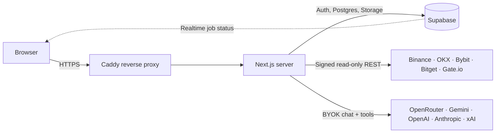

# Architecture

PnLens is a single Next.js 15 application backed by Supabase. The browser talks only to the Next.js server; the server talks to Supabase, to exchange REST APIs, and to the user's chosen AI provider. There is no separate worker service: long-running work (exchange scans, PNL calculation) runs on the same server after the HTTP response is sent, using Next.js `after()`.



## Repository layout

| Path | Contents |
|---|---|
| `src/` | The Next.js app (`package.json`, configs and middleware live here). `@/` maps to `src/`. |
| `src/app/` | Pages (App Router) and `api/**/route.ts` handlers. |
| `src/lib/` | Server logic, organized by layer (below). |
| `src/components/` | React UI, grouped by feature. |
| `src/tests/` | Vitest unit and integration tests. |
| Database schema | SQL migrations for tables, RLS policies, RPCs and storage policies. Not published; see [Contributing](CONTRIBUTING.md#database-schema). |

## Request flow

```
middleware.ts  →  app/api/**/route.ts  →  lib/services/*  →  lib/engines/*   (pure calculation)
  session gate      auth + Zod parse        use-cases          lib/db/*        (Supabase tables)
                                                               lib/adapters/*  (exchange HTTP)
```

- **Middleware** refreshes the Supabase session cookie, gates protected pages and API prefixes, and rejects oversized request bodies.
- **Route handlers** follow one shape: authenticate, validate with Zod (`lib/validators`), call a service, map the result to `{ success, data, error }` with an HTTP status. Error codes are `SCREAMING_SNAKE_CASE`.
- **Services** return a `Result<T>` instead of throwing for business failures.
- **Engines** are pure functions with no I/O, which keeps PNL math fully unit-testable.

## Exchange integration

Each venue implements a common `ExchangeAdapter` (`lib/adapters/exchangeFactory.ts`): credential validation, trade history, balances and open positions. Shared modules handle HTTP retries, request signing (HMAC, RSA, Ed25519), private-key parsing, and field normalization.

**Connect** (`POST /api/exchange/connect`)

1. Validate the key format for the venue (HMAC secret or PEM private key).
2. Probe the exchange for the key's permissions. Keys with trade, withdraw or transfer rights are rejected; IP, region and clock-drift failures map to specific error codes.
3. Encrypt key, secret and passphrase with AES-256-GCM and store them in `api_keys`, linked to an `exchange_accounts` row.

**Sync** (`POST /api/exchange/sync`)

1. Atomically claim the account (`sync_status = syncing`). Concurrent syncs get `409`, syncs inside the cooldown get `429` with `Retry-After`, and stale claims expire.
2. Respond `202 Accepted` immediately.
3. In `after()`, `runScan` decrypts the key, fetches the venue's full lookback window (90–180 days) in pages and time windows, normalizes each fill, and upserts into `trades` in batches. Rows with invalid timestamps or fields are dropped and counted.
4. Write the final `sync_status` and `sync_error`. The client polls the account until it leaves `syncing`.

Every scan re-reads the full window rather than syncing incrementally, so missed or late fills are recovered on the next run.

## PNL engine

Dashboard figures are aggregated by PnLens from the `trades` table with one method for every exchange. For futures, each trade's realized PNL is the exchange's own per-trade value; PnLens does not use any exchange's account-level PNL summary.

- `lib/engines/pnlEngine.ts` produces summaries, chart series, calendars, and fee and volume breakdowns from each trade's realized PNL. Spot trades are stored with `realized_pnl = null` on purpose: spot assets can be withdrawn to or deposited from external wallets, so PnLens cannot know their cost basis and does not compute spot PNL.
- Day boundaries are fixed at UTC+7. "Year" means calendar year-to-date in that offset.
- **Calculate** (`POST /api/pnl/calculate`) enqueues a row in `pnl_calculation_jobs` and runs it in `after()`, writing results to `pnl_snapshots`. The dashboard subscribes to the job row through Supabase Realtime and refreshes when it completes.

## AI assistant

`POST /api/ai/chat` returns a Server-Sent Events stream.

1. The message is stored in `chat_messages` under a `chat_conversations` row.
2. The agent loop (`lib/agent-loop.ts`) sends the conversation to the provider the user selected, using that user's own encrypted API key (`user_ai_providers`).
3. The model can call four tools: trade history, PNL stats, market quotes, and crypto news. Tool results are fed back for a bounded number of steps.
4. Progress (thinking, tool start and finish), content chunks, and errors stream to the browser as typed events.

## Demo trading

A futures simulator on live prices, isolated from real exchange data. Orders, positions and balances live in `demo_trades` and are changed only through Postgres RPCs (`demo_open_order`, `demo_transition_trade`, `demo_set_balance`), so balance changes are atomic and cannot be written directly by the client. Supports market and limit orders, cross and isolated margin, 1x–200x leverage, take profit and stop loss, and a 0.1% taker fee.

## Data model

| Table | Purpose |
|---|---|
| `users` | Profile, display name, avatar URL. |
| `exchange_accounts` | One row per connected venue: label, active flag, sync status, last sync. |
| `api_keys` | Encrypted exchange credentials and key format. |
| `trades` | Normalized fills from every venue, keyed for idempotent upsert. |
| `pnl_calculation_jobs` | Queued and running PNL calculations (Realtime-enabled). |
| `pnl_snapshots` | Calculated PNL results per user. |
| `demo_trades` | Demo orders, positions and history. |
| `chat_conversations`, `chat_messages` | AI assistant history. |
| `user_ai_providers` | Encrypted AI provider keys and status. |

Row-level security is enabled on every table. Users can only read their own rows; background jobs use the service-role client on the server.

## Security

| Concern | Control |
|---|---|
| Exchange keys | Read-only enforced at connect; AES-256-GCM at rest. |
| AI keys | Verified before save, encrypted at rest, never returned to the client. |
| Data isolation | Supabase RLS on all tables; service role used only server-side. |
| Sessions | Supabase Auth (email/password, Google OAuth) with session cookies refreshed in middleware. |
| Abuse | Per-user limit on key validation attempts; scan cooldown and single-flight claims; debug routes disabled in production. |
