

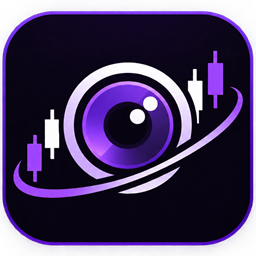

# PnLens

**One read-only view of your real PNL across Binance, OKX, Bybit, Bitget and Gate.io.**

Connect a read-only API key, sync your full trade history, and see profit, fees and volume in one dashboard. Practice in a risk-free futures sandbox and ask an AI assistant about your own numbers.

[Live app](https://pnlens.duii.dev) · [How it works](https://pnlens.duii.dev/how-it-works) · [Architecture](ARCHITECTURE.md)

 

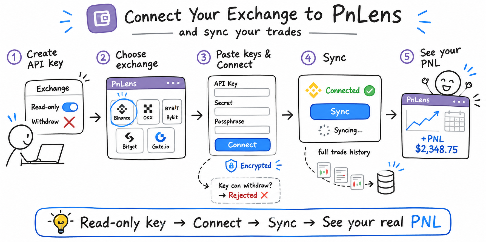

---

## Contents

- [Why PnLens](#why-pnlens)
- [Features](#features)
- [Supported exchanges](#supported-exchanges)
- [Security model](#security-model)
- [Tech stack](#tech-stack)
- [Roadmap](#roadmap)
- [Documentation](#documentation)
- [Contact](#contact)
- [License](#license)

## Why PnLens

Traders who use several exchanges end up with several partial pictures: each venue reports its own PNL, its own fees and its own time zone. PnLens pulls the raw trade history from every connected exchange, normalizes it, and computes PNL, fees and volume the same way for all of them.

- **Read-only by design.** Keys that can trade, withdraw or transfer are rejected before they are stored.
- **Full history, every sync.** Each sync fetches the exchange's maximum lookback window and upserts it, so gaps fill themselves.
- **Spot and futures together.** Filter by market type and by exchange, or view everything combined.

## Features

### Dashboard

PNL for today, 7, 30 and 90 days and the year to date, plus total fees, win rate, trade count and traded volume. Every card can be filtered by Spot / Futures and by exchange.

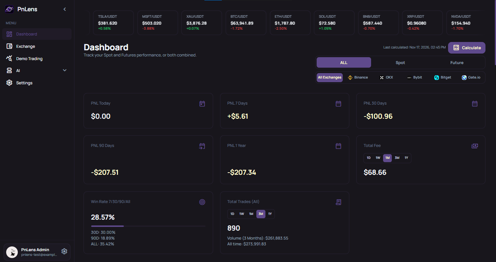

### Performance and PNL calendar

A cumulative PNL chart with daily bars (week, month or year view) and a calendar that shows the result of every day or month.

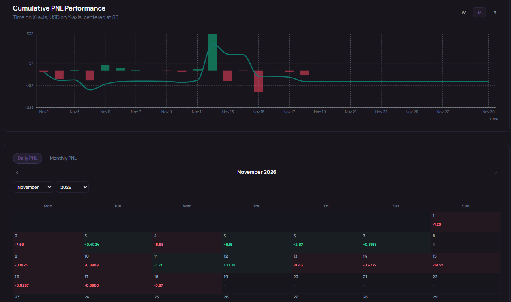

### Trading costs and volume

See what trading actually costs you: total fees, fee rate against volume, and a split by exchange and by Spot / Futures.

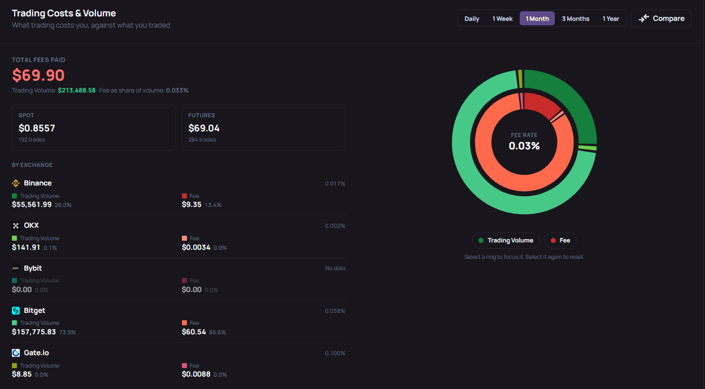

Compare fees and volume across exchanges, market types and periods on one chart.

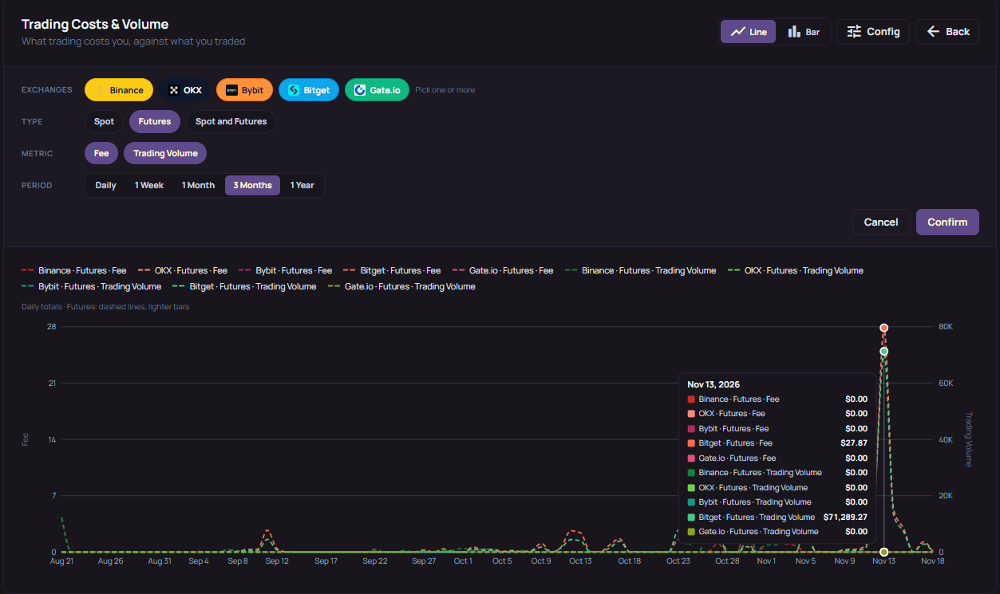

### Recent trades

The latest executed trades with side, price, size, value and realized PNL, filterable by exchange and market type.

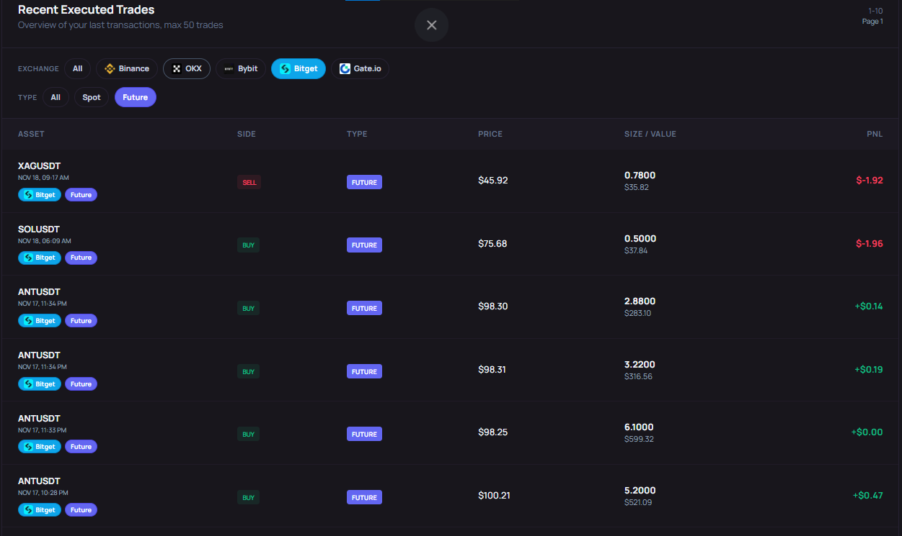

### Exchange connections

Each connected account shows its status, last sync, and key type (HMAC secret or RSA / Ed25519 private key). Syncs run in the background with a cooldown between runs.

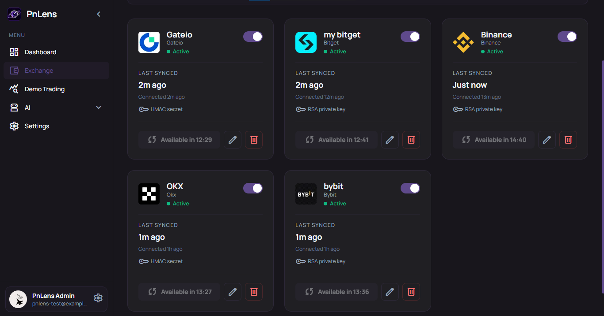

### Demo trading

A futures sandbox on live prices: market and limit orders, cross or isolated margin, leverage from 1x to 200x, take profit and stop loss, and a 0.1% simulated fee. Positions, open orders, order history and trade history update as prices move.

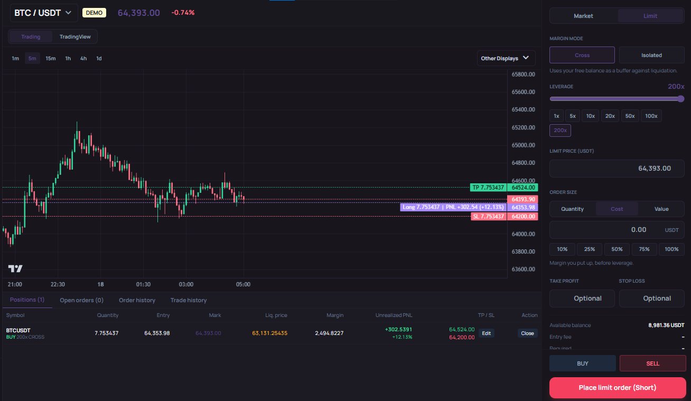

### AI assistant

Ask about your trades, PNL and the market. The assistant calls tools that read your trade history and PNL stats, live market quotes and crypto news, and streams the answer back. Bring your own key for OpenRouter, Gemini, OpenAI, Anthropic or xAI and pick the model and reasoning effort per message.

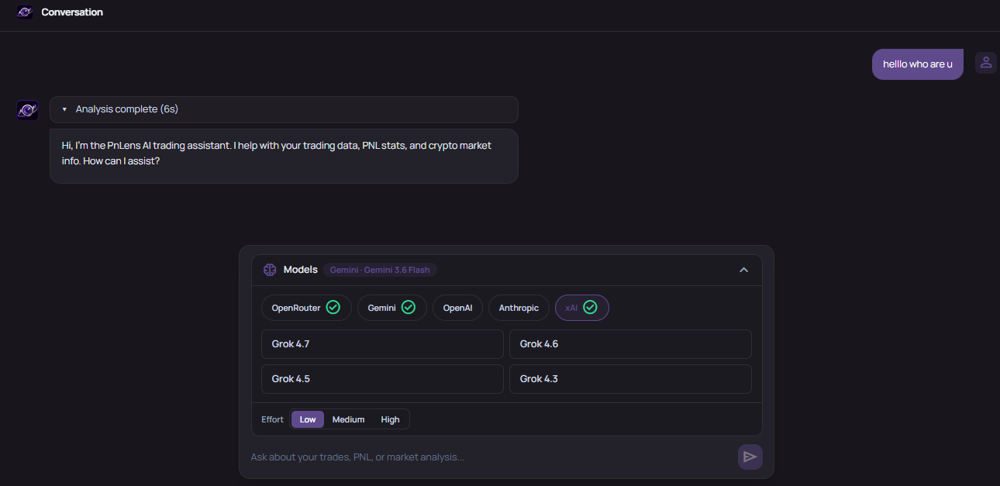

### Settings

Profile and avatar, password, connected exchanges, and AI provider keys. Provider keys are verified before saving, encrypted at rest, and never shown again.

  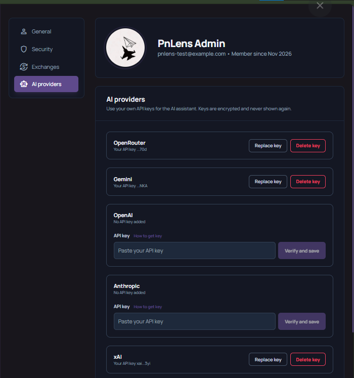

## Supported exchanges

| Exchange | Credentials | Max history per sync |
|---|---|---|
| Binance | API key + Ed25519 / RSA private key | 180 days |
| Bybit | API key + RSA private key | 180 days |
| OKX | API key + secret + passphrase | 90 days |
| Bitget | API key + passphrase + RSA private key | 90 days |
| Gate.io | API key + secret | 90 days |

> [!IMPORTANT]
> Create keys with **read permission only**. Keys with trade, withdraw or transfer permission are rejected.
> Do **not** enable an IP whitelist on the key: PnLens calls the exchange from its own servers, so a key locked to your home IP may be refused.

## Security model

- **Read-only enforcement.** On connect, PnLens asks each exchange for the key's permissions and refuses anything beyond read access.
- **Encryption at rest.** API keys, secrets, passphrases and AI provider keys are encrypted with AES-256-GCM before they reach the database. The master key lives only in server environment variables.
- **Row-level security.** Every user table in Supabase Postgres is protected by RLS. Background scans use the service role on the server only.
- **Server-side sessions.** Supabase Auth (email/password and Google OAuth) with route protection in Next.js middleware.

## Tech stack

| Layer | Technology |
|---|---|
| Framework | Next.js 15 (App Router, Route Handlers, `after()` background work) |
| Language | TypeScript (strict) |
| UI | React 18, Tailwind CSS 3, Lucide icons |
| Charts | Recharts, Lightweight Charts, TradingView widget |
| State and forms | TanStack Query, Zustand, React Hook Form, Zod |
| Data and auth | Supabase Postgres, Auth, Storage, Realtime |
| AI | Bring-your-own-key: OpenRouter, Gemini, OpenAI, Anthropic, xAI |
| Testing | Vitest |
| Hosting | Ubuntu VM behind Caddy (HTTPS), Supabase |

## Roadmap

| Area | Item | Status |
|---|---|---|
| AI | Smarter market news: curated sources and exchange announcements, with every answer citing source and time |  |
| AI | More providers and the latest models, with a capability badge per model |  |
| AI | Custom instructions and reusable analysis skills (weekly review, portfolio health check) |  |
| AI | Strategy what-if: replay your own trades under rules like "stop after 2 losses a day" |  |
| AI | Opt-in weekly report by email and alerts on unusual drawdown or overtrading |  |
| Exchanges | More centralized exchanges and brokers |  |
| Data | Export trade history and PNL to CSV / Excel |  |

Have a request? [Get in touch](#contact).

## Documentation

- [Architecture](ARCHITECTURE.md): system overview, request flow, sync pipeline, PNL engine and data model.
- [Contributing](CONTRIBUTING.md): local setup, checks, code guidelines and pull requests.

## Contact

Found a bug, have a question, or need the database schema to run PnLens locally? Reach out:

  
  
  

Please report security issues privately through one of these channels instead of opening a public issue.

## License

[MIT](LICENSE)
